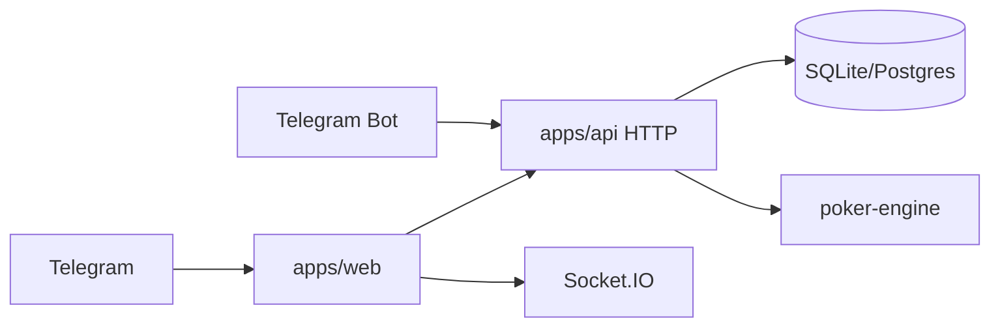

# Architecture — Private Telegram Hold'em Club

## Stack (locked)

| Layer | Choice |
|-------|--------|
| Monorepo | npm workspaces |
| Mini App | React + Vite + `@twa-dev/sdk` |
| API | Fastify + TypeScript |
| Realtime | Socket.IO |
| Engine | `packages/poker-engine` (Texas Hold'em state machine) |
| DB | SQLite via Prisma (local-friendly; swap to Postgres in prod) |
| Locks / live tables | In-process + optional Redis later |
| Bot | `grammy` for invites / admin commands |

## High-level flow

## Screens (Mini App)

1. **Gate** — validate session; if not whitelisted → invite code form.
2. **Lobby** — balance, create/join cash tables, open invites (admin).
3. **Table** — seats, board, pot, action buttons, avatars, seat timer.
4. **Wallet** — balance, create crypto deposit intent, history.
5. **Chat** — table-scoped messages (panel on table screen).

## HTTP API

| Method | Path | Purpose |
|--------|------|---------|
| POST | `/auth/telegram` | Validate initData → JWT session |
| POST | `/auth/invite` | Redeem invite → whitelist |
| GET | `/me` | Profile + balance |
| GET | `/tables` | List open tables |
| POST | `/tables` | Create table |
| POST | `/tables/:id/join` | Sit with buy-in |
| POST | `/wallet/deposit` | Create deposit intent |
| GET | `/wallet/ledger` | Chip movements |
| POST | `/admin/invites` | Create invite (admin) |
| POST | `/admin/deposits/:id/confirm` | Credit chips |

## Socket.IO events

### Client → server
- `table:subscribe` `{ tableId }`
- `table:action` `{ action, amount? }` — fold/check/call/bet/raise/all-in
- `table:leave`
- `chat:send` `{ text }`

### Server → client
- `table:state` — full public table snapshot (+ private hole cards to actor)
- `table:error` — illegal action / not your turn
- `chat:message` — `{ userId, name, avatarUrl, text, at }`
- `wallet:update` — balance after buy-in / cash-out

## Database (Prisma)

- `User` — telegramId, name, username, avatarUrl, role, whitelisted, balance
- `Invite` — code, maxUses, uses, createdById, expiresAt
- `Table` — blinds, maxSeats, status, createdById
- `TableSeat` — tableId, userId, seatIndex, stack, sittingOut
- `Hand` — tableId, handNo, board, pot, winners JSON, history JSON
- `LedgerEntry` — userId, kind, amount, meta
- `DepositIntent` — userId, amountChips, asset, status, externalRef
- `ChatMessage` — tableId, userId, text

## Game engine responsibilities

- Shuffle with `crypto.randomBytes`
- Post blinds, deal, betting rounds, side pots, showdown
- Enforce turn order + action legality
- Emit serializable public/private views
- Persist hand history after showdown

## Deposit flow (crypto MVP)

1. User requests deposit for N chips.
2. Server creates `DepositIntent` (pending) + shows pay instructions / provider invoice stub.
3. Admin confirms (or webhook) → ledger credit + balance update.
4. User buys in at table → chips move table stack ↔ balance.

## Security

- Never trust client for cards, pot, or balance.
- HMAC-check Telegram `initData` (skip only in `DEV_BYPASS_AUTH=1`).
- Action lock per table (mutex) to prevent double-submit.
- JWT short-lived; refresh via re-validate initData.
